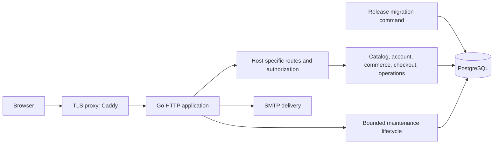

# Deployment architecture and implementation plan

## Decision

Keep Sokomoko as a modular monolith: one Go binary, PostgreSQL, server-rendered
HTML, and a TLS reverse proxy. This preserves the existing transactional boundary
between checkout, payment records, orders, and inventory. There is no evidence
yet that independent services would justify their operational cost.

## Work in this pass

1. Remove simulated payment capture. Offer cash on delivery with a pending
   payment record; reject unimplemented payment methods at the service boundary.
2. Validate production configuration and fail startup on broken email setup.
   Separate migration configuration from web configuration.
3. Run production schema migrations as a release task. Web startup verifies the
   migration history without acquiring DDL privileges or mutating the schema.
4. Give HTTP serving and maintenance an explicit, testable lifecycle. Drain
   requests, stop maintenance, and wait before closing the database pool.
5. Provide a private application network, TLS proxy, immutable image release
   workflow, and a backup/restore runbook. Validate the build and existing suite.

Each step is a separate reviewable commit, with regression coverage for changes
to payment safety, configuration, schema checks, and process lifecycle.

## Launch scope and remaining requirements

The current partner host is a **platform operations workspace**. It uses admin
and staff accounts and can access the entire catalog and all orders. Vendor
accounts require partner membership, query scoping, and fulfillment per partner
before external vendors may receive credentials. Product ownership alone does
not provide tenant isolation.

This pass prepares a cash-on-delivery application deployment. Online payments
require a selected provider, credentials, verified webhooks, reconciliation,
and refund handling. Do not infer payment settlement from order fulfillment.

Shipping, estimated tax, currency, legal policies, SMTP service, DNS, database
backup retention, and recovery objectives need business/operator configuration
before a public launch. The repository cannot supply those decisions.

## Primary references

- [Go 1.26 HTTP shutdown contract](https://pkg.go.dev/net/http@go1.26.9#Server.Shutdown)
- [Docker Compose dependency conditions](https://docs.docker.com/compose/how-tos/startup-order/)
- [Caddy reverse proxy and forwarded headers](https://caddyserver.com/docs/caddyfile/directives/reverse_proxy)
- [PostgreSQL 17 backup format and restore](https://www.postgresql.org/docs/17/app-pgdump.html)

These sources establish platform behavior. The module boundaries and deployment
scope above are architectural judgments based on this repository.
